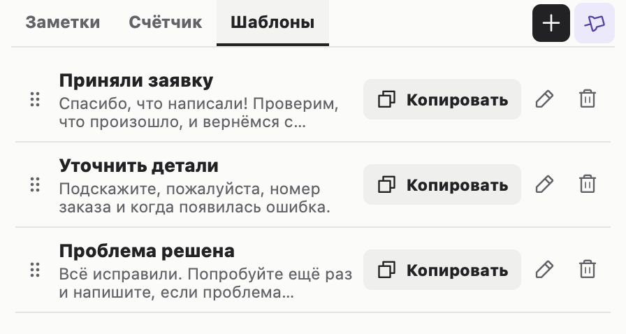

# AnyNotes

[Русский](#русский) | [English](#english)

## Русский

**Заметки поверх окон, счётчик и шаблоны ответов для Mac и Windows.**

Отвечаете клиентам? Запишите номер заявки, посчитайте, сколько обращений закрыли, и вставьте типовой ответ одним нажатием. Закрепите AnyNotes поверх браузера или рабочего приложения, чтобы всё это было перед глазами.

**[Скачать AnyNotes для Mac и Windows](https://github.com/odin337/anynotes/releases/latest)**

- **Заметки.** Держите перед глазами номер заявки, список дел или подсказку. Текст сохраняется автоматически.
- **Счётчик.** Считайте заявки, звонки или любые повторяющиеся действия. После сброса число попадает в историю. В ней хранятся последние десять значений.
- **Шаблоны.** Дайте текстам понятные названия. Копируйте их в один клик и меняйте порядок перетаскиванием.



### Установка

На Mac с Apple Silicon (macOS 13.3 и новее) распакуйте ZIP и откройте `AnyNotes.app`. На Windows x64 запустите установщик `.exe`. Если Windows понадобится WebView2, установщик скачает его.

При первом запуске Mac может попросить подтвердить открытие. [Как открыть скачанное приложение на Mac](https://support.apple.com/en-us/102445)

### Частые вопросы

**Как закрепить заметки поверх всех окон?** Нажмите булавку. Окно можно уменьшить до размера стикера, а на Mac оно остаётся на виду и в полноэкранном режиме.

**Как считать обращения, пока я работаю в браузере?** Закрепите AnyNotes и нажимайте ↑ или ↓. Стрелки меняют счётчик, а браузер продолжает получать нажатия. На Mac нажмите кнопку разрешения мониторинга ввода, если она появится.

**Где хранятся данные?** Заметки, тексты шаблонов и история счётчика остаются на вашем компьютере.

### Поддержка

Если AnyNotes пригодился, поставьте звезду на GitHub. Нашли ошибку или хотите предложить улучшение? [Напишите в Issues](https://github.com/odin337/anynotes/issues).

## English

**Always-on-top sticky notes, a desktop tally counter, and canned responses for Mac and Windows.**

Work in customer support? Jot down a ticket number, count the cases you've closed, and copy a reply you use all the time. Pin AnyNotes above your browser or help desk to keep it within reach while you work.

**[Download AnyNotes for Mac and Windows](https://github.com/odin337/anynotes/releases/latest)**

- **Notes.** Write down the things you need to remember. Your notes save as you type.
- **Counter.** Count tickets, calls, or anything you do repeatedly. Reset it to start from zero and keep the last ten totals in history.
- **Templates.** Name your saved replies, copy them with one click, and drag them to change the order.

### Installation

On an Apple Silicon Mac (macOS 13.3 or later), unzip the archive and open `AnyNotes.app`. On Windows x64, run the `.exe` installer. It downloads WebView2 if Windows needs it. The app interface is currently in Russian.

macOS may ask you to confirm the first launch. [How to open a downloaded Mac app](https://support.apple.com/en-us/102445)

### Common questions

**How do I keep sticky notes above other windows?** Click the pin and resize the window to fit the space you have. On Mac, the pinned window also stays above full-screen apps.

**Can I tally support tickets while I work in my browser?** Pin AnyNotes and press ↑ or ↓. The browser still gets the keypresses. On Mac, click the Input Monitoring permission button if it appears.

**Where is my data stored?** Your notes, text templates, and counter history stay on your computer.

### Support

If you use AnyNotes, a GitHub star helps others find it. Found a bug or have an idea? [Open an issue](https://github.com/odin337/anynotes/issues).

## Сборка из исходников / Build from source

Установите Node.js, Rust и [зависимости Tauri](https://v2.tauri.app/start/prerequisites/) для вашей системы.

Install Node.js, Rust, and the [Tauri prerequisites](https://v2.tauri.app/start/prerequisites/) for your platform.

```sh
npm ci
npm start
```

`npm run package:mac` создаёт ZIP на Mac, `npm run package:win` собирает установщик Windows x64. Результаты находятся в `dist`.

Run `npm run package:mac` on a Mac for a ZIP archive, or `npm run package:win` for the Windows x64 installer. Find both in `dist`.
